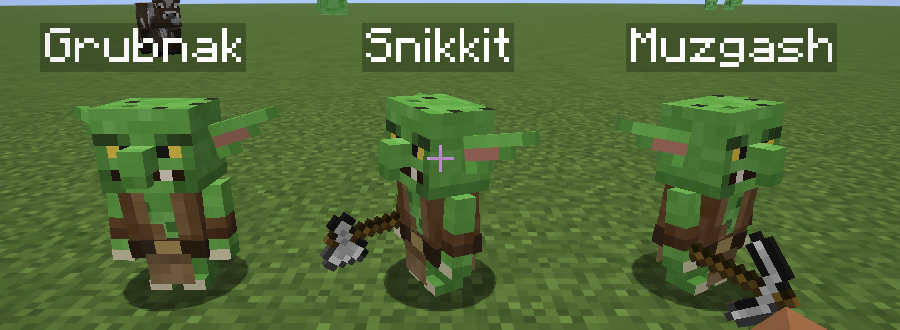
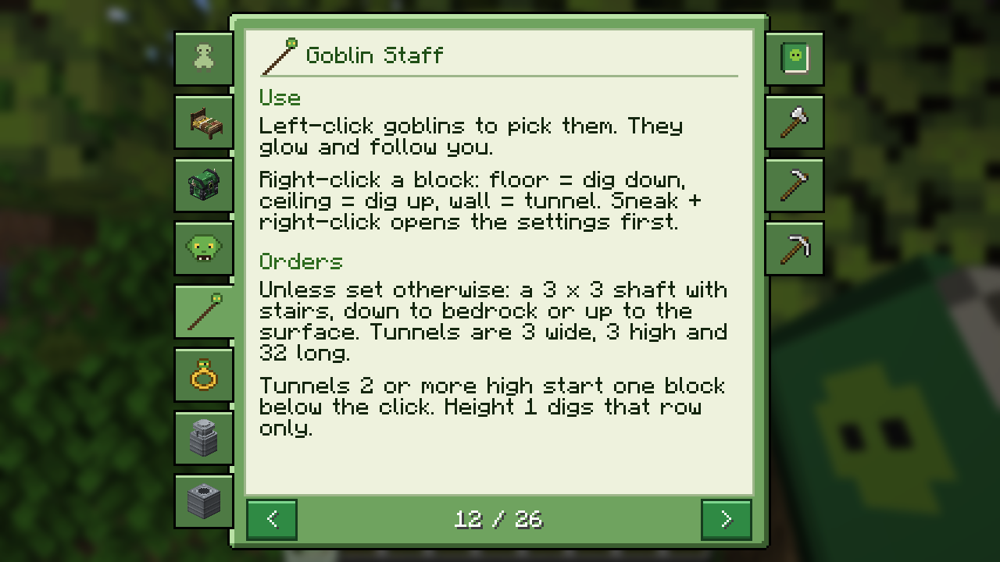

# Goblin Labour


Goblin workers for Minecraft 26.2 (Fabric). Craft a **goblin** out of rotten flesh, give it a **Goblin Straw Bed** and
some tools, and it chops, farms, collects and digs for you while you do something more interesting. Goblins unload
into **Goblin Chests**, the **Goblin Staff** sends them to dig shafts and tunnels, the **Goblin Ring** calls a mining
crew to your side, and the **Milk Can** takes what the farmers milk. Everything is in its own creative tab,
*Goblin Labour*.



## Download

Get `goblinlabour-<version>.jar` from [CurseForge](https://www.curseforge.com/minecraft/mc-mods/goblin-labour) or the
[GitHub releases](../../releases) and put it into `mods/` on the client and the server, next to Fabric API. Requires Minecraft 26.2, Fabric Loader 0.19.3+ and Java 25.

The mod is in early development and playable; there is no release yet, so until then build the jar yourself (see
[Building](#building)). Furniture in the home that makes goblins better at their job is planned.

## The guide book

Every player gets a **Goblin Labour Guide** the first time they join: a book with a chapter for every item and block,
with the recipes, in English and German. Right-click opens it; the things' tabs are on the left, the topics' on
the right. Lost it? Craft a new one from a book and rotten flesh, or take it from the creative tab.

This page follows the book chapter by chapter and adds the details that do not fit on its pages.



<!-- listing:skip -->
| Chapter | |
|---|---|
| [Getting Started](#getting-started) | from rotten flesh to a working goblin |
| [Goblin Blank](#goblin-blank) | a goblin before it wakes up |
| [Goblin Straw Bed](#goblin-straw-bed) | where a goblin lives, its job menu and its home |
| [Goblin Chest](#goblin-chest) | where goblins unload, in sixteen colours |
| [Goblin Head](#goblin-head) | shows the borders of the homes |
| [Goblin Staff](#goblin-staff) | picks goblins and orders shafts and tunnels |
| [Goblin Ring](#goblin-ring) | a mining crew at your side for five minutes |
| [Milk Can](#milk-can) | ten buckets of milk |
| [Milk Can Expansion](#milk-can-expansion) | a twenty bucket tank that pipes can reach |
| [Jobs](#jobs) | Rest, Chop, Farm, Collect |
| [Farming](#farming) | what a farmer does with which tool |
| [Tools and Dangers](#tools-and-dangers) | tools, torches, scaffold, death |

Not in the book: [Commands](#commands), [Building](#building).
<!-- listing:end -->

## Getting Started

Goblins dig, chop, farm and collect for you. Each one lives in a straw bed, works from there and calls for help in
chat.

> *"Reporting for duty, boss!"*

1. Craft nine rotten flesh into a **Goblin Meat Pack** and smelt (or smoke) it into a **Goblin Blank**.
2. Put a **Goblin Straw Bed** down and right-click it with the blank: a goblin with a random name appears and is bound
   to that bed.
3. Right-click the goblin and give it tools.
4. Put a **Goblin Chest** near the bed, then right-click the bed and pick a job.

Goblins talk in chat, in English, server-wide: when they start, get picked or ordered with the staff ("Yes, master!"),
finish a job, come back from the dead, run out of storage, or cannot find a way out of their home. While working they
chatter now and then ("Working, working, working!", "I love my job!"). They also have voices: pitched-up villager and
witch sounds defined in `sounds.json`, so a resource pack can replace them.

A goblin's skin shows its trade: lumberjacks (Chop) are green, farmers yellowish, miners (staff orders) greyish,
collectors (Collect) bluish and carry a small leather backpack. Resting keeps the last colour. On top of that every
goblin has one of four looks, picked by its name so it survives death and blanks: plain leather vest and tusks; patched
vest, gold earrings, a scar and a notched ear; sackcloth tunic, bandage, nose ring and a taller skull; fur collar, bone
necklace, a single fang and a topknot with a braid.

All screens use a goblin-green look; every setting (radius, shaft size, stairs, target height, tunnel width, height,
length) has a tooltip.

## Goblin Blank

A goblin that is not awake yet. A straw bed wakes it, and it keeps its name for good.

> *"My bed! Where's my bed?!"*

**Crafting** – nine rotten flesh, shapeless, make a **Goblin Meat Pack**; smelt or smoke the pack into a blank:

```
R R R
R R R      R = rotten flesh
R R R
```

**Use**

- Right-click a Goblin Straw Bed with the blank: a goblin with a name of its own moves in.
- Break the bed and the goblin goes back into its blank, which keeps the goblin's name and tools.

## Goblin Straw Bed

Where a goblin lives and works from. A cot of bark poles with a straw heap, a sack pillow and a patchwork blanket, a
block and a half long.

> *"Staying here."*

**Crafting** – six hay bales, the lower two rows of the crafting grid:

```
H H H
H H H      H = hay bale
```

**Use**

- Right-click the bed to pick its goblin's job (Rest, Chop, Farm or Collect, see [Jobs](#jobs)), the radius and, for
  Chop, replanting on or off.
- The pillow ends up away from you and the foot end reaches half a block back towards you, so that half block has to
  be free (grass or snow there is cleared; stand one block further back if the bed will not go down). The foot end is
  solid like the rest of the bed, and nothing else can be placed into the block it reaches into: no other block and no
  second bed, so two beds never overlap.
- Put a bed onto a bed and they make a **bunk bed**: the upper one turns the way the lower one does, and the lower
  one's foot posts run up to carry it. The goblin of the upper bed climbs in from the ground beside it.
- The bed shows the trade: while its goblin works, something lies under the frame (an axe, logs or sticks for
  lumberjacks; wheat, vegetables, a hay bale or a hoe for farmers; diamonds, emeralds, redstone or a chunk of ore for
  miners; bundles or a small barrel for collectors). Each bed picks one of four arrangements; a resting goblin's bed is
  empty underneath.

**The home** – every bed has a home: 5 blocks in every horizontal direction and 2 up and down (11 x 11 x 5). Goblins
never mine inside a home, and goblin chests placed in a home are where they unload. Homes of several beds that touch
each other merge into one flat. A goblin that cannot get out of its home says so.

## Goblin Chest

Goblins unload into the Goblin Chests of their home, and into no other chest. Mossy green under dark iron bands, with
bone horns on the lid and a green eye on the lock plate; when it opens the lid turns out to be a jaw full of teeth.

> *"No room left for my loot. Empty the chests!"*

**Crafting** – a chest and a Goblin Meat Pack, shapeless.

**Use**

- Put it into a home. Two of them next to each other make a double chest with a bigger set of horns.
- It is iron-bound and sounds like a copper chest, placing, breaking, opening and closing alike, so a pickaxe mines it
  fastest (by hand works too, it always drops).
- The inventory of a goblin is small on purpose (nine stacks, eighteen for collectors): when it is full (or the job is
  done) the goblin unloads into the goblin chests in its home. Copper and other chests are ignored. If nothing fits it
  lies down and complains in chat, then checks again every minute. Empty a goblin by hand while it is on its way home
  (or take out a third of its stacks) and it turns back to work at once.

**Colours** – a dye paints the chest in any of the sixteen colours (the chest plus the dye, shapeless), from any
colour to any other; green dye makes it plain again. Only chests of one colour join into a double chest, and goblins
unload into all of them.

## Goblin Head

A goblin's head on a torch. It shows where the homes end.

> *"There's no way out of our home. Open a door for me!"*

**Crafting** – a Goblin Blank and a torch, shapeless.

**Use**

- Hold the head: the borders of the homes around you show as floating emeralds.

## Goblin Staff

The staff picks goblins and sends them to dig shafts and tunnels.

> *"Yes, master!"*

**Crafting** – a Goblin Blank on two sticks:

```
    B
  S        B = goblin blank, S = stick
S
```

**Use**

- Left-click goblins to pick them: they glow and follow you.
- Right-click a block to send all picked goblins to work at once: the floor starts a 3x3 shaft with stairs down to
  bedrock, a ceiling a 3x3 shaft up to the surface (it starts on the floor below the clicked ceiling: the air between
  floor and ceiling gets its stair steps too, so the stairs reach the ground), a wall a 3x3 tunnel two chunks deep.
- Sneak + right-click opens the settings first: 1x1, 3x3 or 5x5, stairs on or off, target height, tunnel width, height
  and length.

**Orders**

- A tunnel 2 or more high starts one block below the block you click, so looking straight ahead at a wall gives a
  tunnel on the ground you stand on; height 1 digs only the clicked row.
- Several goblins share one shaft or tunnel; a shaft that overlaps another goblin's is refused. Stair steps are placed
  one by one after each layer is dug. Goblins never break cobblestone stairs, so one goblin cannot wreck another one's
  staircase.
- A goblin digging a shaft upwards works from inside the shaft only, never from a cave the shaft cuts into.
- When the order is done the goblins go back to their job.

**Unloading** – left-click a container with goblins picked (a chest, a barrel, a goblin chest, a mod's crate) and they
unload there from now on instead of into their home's goblin chests: at most 48 blocks from the bed, and the same
click on the same chest takes it back. For a ring crew the chest counts for the whole crew. Milk still goes into a
Milk Can at home first. A chest that is gone or no longer holds anything is forgotten, and they go back to the chests
at home.

## Goblin Ring

Calls a personal mining crew of three goblins for five minutes. They mine the ores within about 8 blocks of you and
pick up items.

> *"Shiny rocks for the boss!"*

**Crafting** – a gold ingot in each corner, a diamond in the top middle, three blanks:

```
G D G      G = gold ingot, D = diamond
B   B      B = goblin blank
G B G
```

**Use**

- Right-click calls the crew; right-click again sends it home early. Crew goblins are miners with a diamond pickaxe,
  shovel and axe and belong to no bed; they wear blue-grey clothes, so they are easy to tell from the goblins that
  sleep in your beds.
- They stay within about 8 blocks of you (a staff order aside, see below): a goblin further away walks back, one far
  off (or stuck) blinks back. They keep out of your way: out of your personal space and out of the lane you look or
  walk along, and your clicks and arrows pass through them. With nothing to do they stand about near you and look
  around; now and then one strolls to another spot of its own, so they do not walk into each other. In the dark (a
  cave, a roofed room, not the open sky at night) they put up a few free torches around you.
- They mine the ores around you that they can see (from a spot in reach with a clear view; never inside a home, never
  the block you are mining yourself). Ore comes first: as soon as you uncover some they drop helping or fetching items
  for it, and for ore they may stand right beside or behind you and in the lane you look along. Once they start on an
  ore they take out its whole vein, ores hidden in the rock included (up to 64 blocks), before they turn to any other
  ore; a vein whose last ores are walled in by stone is given up after half a minute.
- When you dig natural ground yourself (stone, deepslate, dirt, sand, gravel and the like: the block tag
  `#goblinlabour:natural`, which a datapack can change; a placed block cannot be told from a generated one), they help
  around the block you broke for 20 seconds: never below your feet, so nobody's floor is dug away, never the block you
  are looking at, never inside a home.
- They pick up loose items nearby, including what a player threw, even in the lane you look along; what you threw
  yourself is left alone for three seconds so you can take it back. Items inside a home are left to the goblins that
  live there.
- They have no inventory of their own and theirs cannot be opened: everything goes into the ring, which holds a double
  chest. Sneak + right-click opens it, in the goblin look: the loot, and a side panel with a crew goblin's portrait and
  two slots for enchanted books. The books' enchantments go onto the crew's diamond pickaxe, shovel and axe (each
  enchantment onto every tool it fits, the higher level where both books have it) as soon as a book goes in or out:
  Efficiency makes the crew dig faster, Fortune and Silk Touch change what the ores drop.
- When a goblin chest is within 16 blocks, one goblin at a time carries the ring's contents over, a stack at a time; a
  carrier is the only one allowed that far off the leash.
- The **Goblin Staff** works on the crew too, for the ring's owner only: with the staff in hand the crew goblins can be
  clicked (otherwise clicks pass through them), picked and sent to dig a shaft or tunnel like bed goblins (same stairs
  and scaffold). A crew goblin picked while it works on an order stops, follows you, and goes back to the order when
  you let go of it. The loot goes into the ring. An order takes them off the leash until it is done: they dig the whole
  shaft or tunnel wherever it leads, however far that is from you, and only go back to your side once it is finished.
  You do not have to follow them in. While on an order they may work in the lane you look along, but still keep out of
  your personal space and your walking path.
- The crew leaves when its time is up, when you log out, die, change dimension or stop carrying the ring, and it is
  never saved with the world. A ring destroyed in lava spills its contents.

## Milk Can

An old grey milk can with two handles that holds ten buckets of milk. Farmers with a bucket fill it.

> *"Moo moo, milk for master!"*

**Crafting** – iron around a pane of glass and a bucket:

```
I G I      I = iron ingot, G = glass
I B I      B = bucket
I I I
```

**Use**

- Right-click with a milk bucket to pour it in, with an empty bucket to fill it; an empty hand opens its screen, shaped
  like the can in dark grey metal: the bucket slot above the output slot and the gauge beside them, with a line for
  every bucket.
- Placed, it turns so the handles are on your left and right. The milk shows at the rim: a drip running over it, then
  milk up to the rim, then milk running down the sides, and a full can has its lid on. A broken can keeps its milk (the
  item shows how much).
- Hoppers put buckets in from the top and the sides and take them out below; a comparator reads the level.

## Milk Can Expansion

A full block tank in the milk can's metal that holds twenty buckets. A Milk Can standing on it pours its milk down
into it, two buckets a second.

> *"Nothing goes to waste!"*

**Crafting** – eight iron ingots around a bucket:

```
I I I
I B I      I = iron ingot, B = bucket
I I I
```

**Use**

- It works like the can: right-click with a bucket, an empty hand opens the same screen without the can's neck and
  handles (the gauge has a line for every bucket), hoppers put buckets in from the top and the sides and take them out
  below, a comparator reads the level, and a broken one keeps its milk.
- Its milk is a fluid (`goblinlabour:milk`, tagged `c:milk`) in Fabric's transfer API, so pipes and storage mods such
  as Refined Storage importers take it out, or put it in, from every side.

## Jobs

Right-click a bed to pick a job and the radius around the bed. Everything goblins bring home goes into the goblin
chests.

> *"Working, working, working!"*

- **Rest**: potter about the home (about nine tenths of the time) and take a short nap in bed now and then (heals fast
  in bed, slowly while awake). Pottering works like a vanilla mob's stroll: a short walk, then a pause of a few seconds
  looking around or at a player or goblin nearby. A goblin outside its home walks straight back.
- **Chop**: fell the trees within the radius one at a time. A goblin claims the tree nearest to it (every log
  connected to it, branches included) and takes it down from the lowest log up before it moves on; other lumberjacks
  leave a claimed tree alone, and the goblin keeps its tree until the last log is down, waiting for logs it cannot
  reach yet instead of leaving them to another goblin (a tree that loses no log for five minutes is given up). It picks
  up its own drops (the logs and the leaves it breaks itself); what the crowns drop later (saplings, sticks, apples) is
  left for a collector. Leaves in the way are cleared: when the only way to a log leads through leaves (jungle bushes,
  a low crown), the goblin breaks the leaves on that way first, like a player hacking a path. High logs are reached by
  climbing Goblin Scaffold (see [Tools and Dangers](#tools-and-dangers)).
- **Saplings**: with *Replant saplings* on (the default, a switch in the bed menu) the stumps of a felled tree get a
  sapling, the tree's own kind first, from its own drops or else from its tool row. Saplings put into the tool row are
  planted out on free ground inside the radius (never in a home): no tree, leaf or sapling closer than 3 blocks, ideally
  4 to 5 blocks apart. Everything in the storage, saplings included, goes into the chests when it unloads.
- **Farm**: a farmer does whatever its tool row has the tools for, see [Farming](#farming).
- **Collect**: pick up loose items within the radius (the home included) and bring them to the goblin chests. Only
  items that have landed where a goblin can walk: what lies on leaves, logs or the top of a scaffold column waits until
  it falls down. Collectors carry a backpack: a second storage row, twice as much loot per trip.

## Farming

A farmer does whatever its tool row has tools for, within the radius and never in a home, the nearest thing first.

> *"Crops grow, goblin harvest."*

- **Hoe**: harvest ripe crops, nether wart, pumpkins, melons and wart blocks and replant them with a seed from the
  drops (or the inventory); harvest ripe cocoa and replant the pod on the same side of the log; pick sweet berries (the
  bush keeps growing) and glow berries; cut sugar cane, bamboo and cactus down to the bottom block. Harvesting needs
  the hoe: a farmer without one leaves ripe crops standing and asks for a hoe.
- **Cocoa beans** in the tool row are planted on free sides of jungle logs (with a hoe).
- **Bucket**: milk grown cows, each cow once every five minutes. At home the milk goes into a **Milk Can** (the bucket
  is used up), what does not fit goes into the goblin chest.
- **Shears**: shear sheep; the wool is picked up and unloaded.
- **Treetap** (Tech Reborn): tap rubber logs with sap, from the side the sap is on, climbing scaffold to sap spots high
  up the trunk; rubber leaves growing right against the trunk are broken first, the rest of the crown stays. The sap is
  picked up and unloaded.

## Tools and Dangers

Goblins only use the tools they carry. Without a pickaxe they cannot break stone, without diamond no obsidian (vanilla
rules).

> *"I can't dig through this with my bare hands. Give me a pickaxe!"*

- **Right-click a goblin**: a player-style inventory titled with its name and trade ("Grubnak the Lumberjack"). Tools
  go into the tool row and never wear out.
- Goblins place free torches where it is dark and seal water and lava with free cobblestone.
- Goblins break blocks like players: the drops pop out onto the ground and the goblin walks over and picks them up
  between two blocks (up on scaffold it keeps working and collects when it is down again; drops that fell far down a
  shaft dug upwards are fetched once the shaft is finished). It only breaks a block it can see: no reaching through
  stair steps or round corners, it walks to a spot with a clear view first (leaves and scaffold do not block the view).
- **Goblin Scaffold** takes them up to high logs: the goblin puts a scaffold block into the block it stands in and
  climbs it like a player holding jump on scaffolding, one block at a time, breaking leaves in the way, and sneaks back
  down through the column. It is vanilla scaffolding with its own block (stand on it, climb inside it, sneak to drop
  through; every block needs support within seven blocks, so breaking the foot of a column brings the whole column
  down), has a brown texture, is not craftable and drops nothing. Players use it like scaffolding too: climb it holding
  jump, sneak to sink down through it, and a scaffold item in hand builds the column up (or, sneaking, sideways).
  Goblins never break it; a column vanishes two minutes after a goblin last touched it, so any goblin can use a column
  another one built, but never while a player stands in it or on top.
- A goblin that wants to go home (resting or unloading) but gets no closer to it, stuck in a hole it cannot walk out of
  like a shaft dug without stairs, climbs out on scaffold. (Goblins shoving each other in a hole never stand still, so
  it is the lack of headway towards the bed that counts, not standing still.) It picks the cheapest column at the side
  of the hole; an existing column costs nothing, so the next goblin in the same hole uses the first one's scaffold.
  Only one goblin climbs a column at a time: the others wait a couple of blocks aside and follow one after the other
  (one already standing at the foot of the column goes next), and a climbing goblin cannot be pushed off its column.
  The top of another scaffold column is never a way out, only real ground is. This works from the far end of a tunnel
  dug off the floor of the hole too, up to 48 blocks away, and through tunnels one block high (goblins are just under a
  block tall). With no way up at all it blinks home.

**Death** – goblins have 20 health, cannot be targeted by monsters and do not fight. Lava, drowning and falls still
kill them; a dead goblin respawns on its bed after five seconds with its tools, the rest of its inventory is dropped
where it died, and it walks back and picks up whatever it dropped, if it is still there.

## Commands

- `/goblinlabour ...` – operator commands for testing (spawn a goblin, set a job, start a ring crew, show a bed's
  status). `/goblinlabour status <bed>` shows a goblin's inventory and what it is doing.

<!-- listing:skip -->
## Building

Java 25, `./gradlew build` → `build/libs/goblinlabour-<version>.jar`. Needs
[bcf-guide-book-lib](https://github.com/david-stefan-hermann/bcf-guide-book-lib) in the local Maven repository first:
`./gradlew publishToMavenLocal` in a checkout of it.

`./gradlew runServer` starts a dev server; the scripts in `tools/` drive it over RCON for tests and screenshots.
`./gradlew runClient -PbookShots` saves every page of the guide book, whose content lives in
`goblinlabour.item.GuideBook`. Goblin textures come from `tools/MakeGoblinTexture.java`, the bed model and its textures
from `art/goblin_bed/build_goblin_bed.py`, the arrangements under the bed and its blockstate from
`tools/MakeBedModels.java`.
<!-- listing:end -->

## Credits

- Inspired by [Minions Remastered](https://github.com/BrassAmber-Mods/MinecarftMinionsRemastered) by jodlodi and
  BrassAmber (LGPL-2.1): the job loop, the spiral stair and the "blink" fallback follow its design. Code, goblin model
  (`GoblinModel`) and textures are this mod's own.

## License

LGPL-2.1, see [LICENSE](LICENSE). By BaconCakeFactory.
